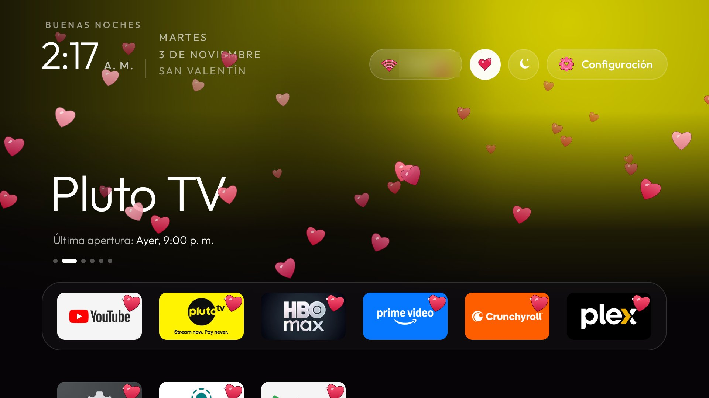

<p align="center">
  <a href="https://cleanyour.tv"></a>
</p>

> [!NOTE]
> **This is a fork of [Gathin23/cleanyourtv](https://github.com/Gathin23/cleanyourtv)** that adds seasonal themes by
> date, background photos from Unsplash, a photo screensaver, a quick panel and a sleep timer to the launcher. [What this fork adds](#what-this-fork-adds) describes the changes. The rest
> of this README is the upstream project, unchanged.

## What this fork adds



| | Upstream | This fork |
|---|---|---|
| Seasonal looks | One festive skin per theme (`festival`, `seasonal_skin`), switched by hand or ended with `festival_until` | **Season packs**: any number of themes, each switched on and off by its own dates and priority |
| What a season changes | Icons and a greeting | Falling particles (built-in or your own PNGs), an ornament on every tile, the Wi-Fi, theme and Settings icons, an accent colour and a background that can rotate |
| Backgrounds by time of day | `wallpaper_moods` (morning, evening, night) for a theme's wallpaper | `background/day/` and `background/night/` inside each season, switched at sunrise and sunset |
| Mistakes in a pack | Not applicable | Listed on the TV under **Theme pack problems** |
| Background photos | Your own wallpaper files | **Internet photos** per theme: found on Unsplash with the theme's own search terms, kept on the TV, changing on their own |
| Screensaver | `ClockDream`, a clock on black | **Photo screensaver**: the active theme's photos first, then your topics, with day and night photos if you want them |
| Holding Home | Android TV's dashboard, where the firmware still has it | A **quick panel** of its own where the dashboard is gone: time, network, picture, sleep timer, apps, settings |
| Sleep timer | The separate Sleep Timer add-on | A moon pill in the top bar of Home, showing the minutes left, and a countdown over any app in the last minute |
| Netflix key on the remote | Fixed by `app_keys` in config.xml | **Assign to Netflix button** in any tile's hold-OK menu |
| Permissions | No new ones | `MANAGE_EXTERNAL_STORAGE`, to read the pack from `/sdcard/TVHome/seasons/`; `INTERNET`, for the photos only |
| APK size | Under the 576 KB gate | About 670 KB |

The launcher only goes online for the photos: it asks Unsplash for search results, pictures and each picture's place
and camera, and nothing else. Without an Unsplash key in the build, the photo features stay off and nothing goes out.
Tested on a Chromecast with Google TV 4K (Google TV 14) with an LG TV.

### Install

The sleep timer, the quick panel and the Netflix button need the key helper, the season pack needs file access,
and the photo screensaver is set as the TV's screensaver once the launcher may write secure settings:

```
(cd launcher && HOME_KEY_SERVICE=1 ./build-and-install.sh)
tools/venv/bin/python -I tools/tv.py 'appops set com.gathin.tvhome MANAGE_EXTERNAL_STORAGE allow'
tools/venv/bin/python -I tools/tv.py 'pm grant com.gathin.tvhome android.permission.WRITE_SECURE_SETTINGS'
```

For the internet photos, create a free app at [unsplash.com/developers](https://unsplash.com/developers) and put its
Access Key in `launcher/local.properties` before building. Git ignores that file, so the key never reaches a commit:

```
unsplash.access_key=<your access key>
```

A demo key allows 50 requests an hour. The first fetch of a theme uses one request per search term, and each photo's
place and camera one more, asked once when the photo first comes on screen.

Seasonal looks are on by default (`seasonal_calendar` in `launcher/app/src/main/res/values/config.xml`). Set it to
`false` to get the upstream Home back.

### The built-in calendar

With no pack on the TV, the launcher uses the pack built into the APK (`launcher/app/src/main/assets/seasons/`). The
four seasons follow the northern hemisphere. A holiday outranks the season around it, because it has a higher
priority.

| Theme | Dates | Priority |
|---|---|---|
| New Year | 31 December to 2 January | 10 |
| Lunar New Year | The first 3 days of the Chinese new year (6 to 8 February 2027) | 10 |
| Valentine's Day | 14 February | 11 |
| Spring | 20 March to 20 June | 0 |
| Summer | 21 June to 22 September | 0 |
| Autumn | 23 September to 20 December | 0 |
| Halloween | 1 to 31 October | 10 |
| Christmas | 1 to 30 December | 10 |
| Winter | 21 December to 19 March | 0 |

### Your own pack

A pack is a folder: an index, `seasons.json`, plus one folder per theme. Images are found by fixed file names,
never named in JSON. Every file except `seasons.json` is optional.

```
my-pack/
  seasons.json                 which themes, on which dates, with which priority
  christmas/
    theme.json                 name, accent, particles, tile ornament
    background.jpg             one background (or background.png)
    particle.png               the falling sprite, with particles.kind "image"
    ornament.png               the tile ornament, with tiles.ornament "image"
    icon-wifi.png              optional top-bar icons, about 66x66 px
    icon-theme.png
    icon-settings.png
  winter/
    theme.json
    background/                several backgrounds, rotated with a cross-fade
      01.jpg
      02.jpg
      day/                     used from sunrise to sunset
        snowy-morning.jpg
      night/                   used from sunset to sunrise
        northern-lights.jpg
    particles/                 several sprites; each particle picks one
      flake-1.png
      flake-2.png
  mothers-day/
    theme.json
    background.png
```

The [`seasons/`](seasons/) folder is a complete example: the nine built-in themes with their particles, ornaments
and icons, all drawn in code. It has no backgrounds, so add your own.

#### seasons.json

```json
{
  "seasons": [
    { "folder": "new-year",    "dates": { "from": "12-31", "to": "01-02" }, "priority": 10 },
    { "folder": "christmas",   "dates": { "from": "12-01", "to": "12-30" }, "priority": 10 },
    { "folder": "mothers-day", "dates": { "rule": "nth-weekday", "month": 5, "weekday": "sunday", "n": 2 }, "priority": 10 },
    { "folder": "holy-week",   "dates": { "rule": "easter", "from": -7, "to": 0 }, "priority": 10 },
    { "folder": "lunar",       "dates": { "rule": "lunar-new-year", "days": 3 }, "priority": 10 },
    { "folder": "winter",      "dates": { "from": "12-21", "to": "03-19" }, "priority": 0 }
  ]
}
```

When several themes cover the same day, the higher `priority` wins; on a tie, the first one listed wins. The four
date rules:

| Rule | Example | Covers |
|---|---|---|
| Fixed range | `{ "from": "12-01", "to": "12-30" }` | The same days every year; a range that ends before it starts wraps over New Year |
| nth weekday | `{ "rule": "nth-weekday", "month": 11, "weekday": "thursday", "n": 4, "days_after": 1 }` | Thanksgiving in the US and the day after. `n` is 1 to 5, or -1 for the last one; `days_before` and `days_after` are optional |
| Easter | `{ "rule": "easter", "from": -7, "to": 0 }` | Days counted from Easter Sunday: here Palm Sunday to Easter |
| Lunar New Year | `{ "rule": "lunar-new-year", "days": 3 }` | The first days of the Chinese calendar's year |

#### theme.json

A theme with your own pictures: particles from `particles/`, an ornament stretched across the top of each tile, and
backgrounds that shuffle every two minutes.

```json
{
  "name": { "en": "Winter", "es": "Invierno" },
  "accent": "#8EC9FF",
  "background_opacity": 35,
  "background_interval": 120,
  "background_order": "shuffle",
  "particles": { "kind": "image", "count": 60, "seconds": 9 },
  "tiles": { "ornament": "image", "corner": "top" }
}
```

A theme drawn entirely by the launcher, with no image files:

```json
{
  "name": { "en": "Spring", "es": "Primavera" },
  "accent": "#FF9FBF",
  "particles": { "kind": "sakura", "colors": ["#FFC6D9", "#FFB0CB", "#FFDDE8"], "count": 45, "seconds": 7 },
  "tiles": { "ornament": "blossom", "corner": "top-right" }
}
```

A national day with a two-colour band on every tile:

```json
{
  "name": { "en": "National Day" },
  "particles": { "kind": "confetti", "colors": ["#FFFFFF", "#D52B1E"] },
  "tiles": { "ornament": "flag_band", "colors": ["#FFFFFF", "#D52B1E"] }
}
```

- Built-in particles: `snow`, `sakura`, `leaf`, `heart`, `confetti`, `spark`, `bats` and `marigold`, plus `image`
  for your own and `none`.
- Built-in tile ornaments: `snow_cap`, `frost`, `blossom`, `sun`, `leaves`, `heart`, `hearts`, `sparkles`,
  `lantern`, `flag_band`, `cobweb`, `marigold` and `candle`, plus `image` and `none`.

[docs/seasons.md](docs/seasons.md) has every field, the size limits for each file and tips for composing
backgrounds.

#### Putting it on the TV

```
tools/season.sh --check my-pack                  # validate only, sends nothing
TV_HOST=192.168.1.50 tools/season.sh my-pack     # check, then replace the pack on the TV
TV_HOST=192.168.1.50 tools/season.sh --reset     # delete it: the built-in pack applies again
```

You can also copy the folder into `/sdcard/TVHome/seasons/` with any file manager on the TV, without a computer.
Home picks the new pack up the next time it comes to the front.

### On the TV

- **Sparkle button**, next to Wi-Fi, shows that theme's icon. It opens the theme menu:
  - **View background** shows the pictures full screen. Left and Right change the picture, Up shows its details
    (description, place, photographer, camera, date and size), Down or Back hides them, Back again returns to Home.
  - **Background**: **Theme** (the pack's own pictures) or **Internet** (photos found with the theme's
    `photos.queries`, which cover the whole screen).
  - **Change photo every** 10 s to 30 min, shown while the background is Internet. Launcher settings has the same
    setting.
  - **Change theme by date** turns the calendar on or off.
  - A list of every theme in the pack, to use one now, whatever the date.
  - **Theme pack problems** appears only when something in the pack was skipped, and says which file and why.
- **Back on Home** opens the photo screensaver, which the TV also starts on its own when idle. It shows the active
  theme's photos first, then **Screensaver topics** from Launcher settings (or a varied mix), and with **Day and
  night photos** on, daylight photos by day and night photos after sunset. The same keys as View background work.
- With a theme on, the cinematic shelf's app-colour glow and artwork stay off, so they never wash over the theme.
- **Hold Home**, where the firmware has no dashboard of its own, for the quick panel.
- **Moon pill**, the sleep timer. Choose 1, 10, 20, 30, 60, 90, 120, 180 or 240 minutes, or Off.
  - While it runs, the pill shows the minutes left.
  - In the last minute a countdown stays at the top of the screen, over any app, until the box goes to standby.
  - With HDMI-CEC on (SIMPLINK, Anynet+, BRAVIA Sync and the like), the TV turns off with the box.
  - The timer keeps running while another app is in front.
- **Assign to Netflix button**, in the menu that opens when you hold OK on a tile: the remote's Netflix key then
  opens that app.

<p align="center">
  Read in: <a href="README.zh-CN.md">简体中文</a> · <a href="README.zh-TW.md">正體中文</a> · <a href="README.vi.md">Tiếng Việt</a> · <a href="README.ja.md">日本語</a> · <a href="README.it.md">Italiano</a> · <a href="README.nl.md">Nederlands</a> · <a href="README.de.md">Deutsch</a> · <a href="README.uk.md">Українська</a> · <a href="README.tr.md">Türkçe</a>
</p>

<p align="center">
  <a href="https://github.com/Gathin23/cleanyourtv/stargazers"></a>
  <a href="https://github.com/Gathin23/cleanyourtv/pulls?q=is%3Amerged"></a>
  <a href="https://github.com/Gathin23/cleanyourtv/network/members"></a>
  <a href="https://github.com/Gathin23/cleanyourtv/graphs/contributors"></a>
  <a href="https://buymeacoffee.com/gathint"></a>
  <a href="https://www.producthunt.com/products/cleanyourtv"></a>
</p>

<p align="center">
  <a href="https://trendshift.io/repositories/310225"></a>
</p>

<p align="center">
  <a href="docs/PRESS.md"></a>
</p>

## Start here

| You have | Go to |
|---|---|
| **An Android TV or Google TV** | [Quick start](#quick-start): a coding assistant does the work in about fifteen minutes. |
| **A Samsung, LG, Roku, Vizio or Hisense VIDAA TV** | [cleanyour.tv/not-android](https://cleanyour.tv/not-android): CleanYourTV can't run there, but you can turn off the tracking with your remote. |
| **A phone or laptop, no coding agent** | One of the [community apps](https://cleanyour.tv/app) for Android phones, Mac and Windows, made by independent developers. |
| **Want to see it first** | [What you get](#what-you-get): screenshots of the new home screen. |

**Official links:** [cleanyour.tv](https://cleanyour.tv) and this repo. Other domains using the name, such as
cleanyourtv.com, are not run by this project ([#1004](https://github.com/Gathin23/cleanyourtv/issues/1004)).
CleanYourTV publishes no app in any app store, and clean-your-tv.net is not ours either.

[How it works](#how-it-works) · [Quick start](#quick-start) · [What you get](#what-you-get) ·
[Supported TVs](#supported-tvs) · [Doing it by hand](#doing-it-by-hand) · [The launcher](#the-launcher) ·
[Restoring](#restoring-your-tv) · [Firmware updates](#after-a-firmware-update) ·
[Questions](#questions-people-ask) · [Contributing](#contributing)

## How it works

Android TVs have the same debug bridge as Android phones. Switch on USB debugging in the TV's
developer options, allow your computer once, and the rest is standard Android tooling:

| Step | What happens |
|---|---|
| **Back&nbsp;up** | The list of installed packages and settings. |
| **Disable** | The manufacturer's telemetry, ad services, content rows and preloaded junk, with `pm disable-user`. Nothing is uninstalled, so a restore script can undo every step. |
| **Install** | A small native launcher, made the default home screen. |

**No root, no cable, nothing uninstalled, and a one-line restore if you change your mind.**

The bloat differs by brand, so the prompt has your coding assistant discover it on your TV and ask
before touching anything you might use.

## Quick start

| You have | Do this |
|---|---|
| **A computer** | Use the prompt with a coding assistant: the three steps below. |
| **A computer, no coding assistant** | Run the three steps yourself: the commands are in [Doing it by hand](#doing-it-by-hand). |
| **A phone or laptop, no coding assistant** | Pick one of the [community apps](https://cleanyour.tv/app): free, open-source apps built on these TV lists by independent developers. |

The three steps below are written for a coding assistant: the computer needs to be on the same Wi-Fi as
the TV, with a shell on it, plus Python 3, a JDK from 17 through 22, and Android SDK platform 34
with build-tools 34 (the assistant builds the launcher there).
Without an assistant, [Doing it by hand](#doing-it-by-hand)
is the same job, run by you, and it has the install commands.

Any of these work: Claude Code (on [0G Private Computer](https://pc.0g.ai/?utm_source=cleanyourtv&utm_medium=github&utm_campaign=readme) or an [Anthropic plan](https://claude.com/pricing)), [Codex](https://github.com/openai/codex), [Gemini CLI](https://github.com/google-gemini/gemini-cli) or [Antigravity CLI](https://antigravity.google/product/antigravity-cli).

| Where | What to do |
|---|---|
| **1. On the TV** | Settings → Device Preferences → About → press OK on **Build** seven times → back → Developer options → **USB debugging** on. If you see a Network or ADB debugging toggle, turn that on too. Keep the TV on. |
| **2. On your computer** | Clone the repo and open that folder in your assistant (`git clone https://github.com/Gathin23/cleanyourtv`), then paste [`PROMPT.md`](PROMPT.md) and fill in your TV model. |
| **3. Follow along** | Accept "Allow USB debugging?" on the TV, then answer the checklist: which apps you use, the dock size and app order, whether to keep the voice assistant, Chromecast and updates. |

Cloning matters: the assistant reuses this repo's `tools/disable.sh` and `launcher/build-and-install.sh`
instead of writing its own, and that is where the backup, the Home guard and the restore record live.

The assistant backs up, debloats, builds and installs the launcher, and checks each step with
screenshots pulled from the TV. With this repo as context it takes about fifteen minutes.

## What you get

A home screen that looks like an Apple TV and gets out of the way:

| Part | What it looks like |
|---|---|
| **A pitch-black home** | A dock of your four favourite apps in a rounded band, where Apple TV puts it. |
| **A top shelf** | Names the focused app in large type, with an ambient glow in a colour taken from its artwork. |
| **The rest of your apps in a grid** | Slides up when you press Down. |
| **One floating glass highlight** | Springs from tile to tile. The focused tile lifts and shows its name. |
| **Three frosted buttons** | Inputs (HDMI ports under the names you gave them in the TV's settings, AV, Live TV), Wi-Fi or Ethernet with the network name, Settings. |
| **A greeting, a thin clock and the date** | In [Outfit](https://fonts.google.com/specimen/Outfit), and a matching Clock screensaver. Set `show_stats` in config or a theme for one line under the clock: CPU, free memory and free storage. It stays off unless you turn it on, and it refreshes only while Home is on screen. |
| **Themes and module cards** | Themes change colours, wallpaper, dock and columns without a rebuild, and module cards let other apps plug a tile in, only with your say-so. |

And a TV that stops working against you: no sponsored rows, no "Discover" nags, no analytics
phoning home, no apps you never asked for.

| | |
|---|---|
|  |  |
| *Top shelf and ambient glow* | *Inputs: HDMI with connection state, AV, Live TV* |
|  |  |
| *The grid, one glass highlight, the tile's name* | *Clock screensaver, drifts so nothing burns in* |
|  |  |
| *Aurora theme, pushed with `tools/theme.sh`* | *Six columns and a six-app dock, same launcher* |
|  |  |
| *Hold OK on a tile, Move: arrows carry it, Back puts it down* | *App library: one press puts a removed app back on Home* |

## Supported TVs

Anything running **Android TV** or **Google TV**.

| Platform | What works |
|---|---|
| **Android TV, Google TV** | The debloat and the launcher. |
| **Fire TV** | The debloat half only, since Fire OS will not hand Home to a third-party launcher. And on the 2015 Fire TV Box (Fire OS 5) even that half fails: every `pm` route is refused. |
| **A few China-market TCL sets** | They refuse to install any launcher at all; their lists say so in the header. |
| **Samsung (Tizen), LG (webOS), Roku, Vizio, Hisense VIDAA** | Not supported (no ADB). Turn off the tracking instead: [cleanyour.tv/not-android](https://cleanyour.tv/not-android). See [SHOWCASE.md](SHOWCASE.md#other-platforms-fire-tv-and-lg-webos) for four webOS ports, and [docs/devices/samsung-tizen.md](docs/devices/samsung-tizen.md) for what a 2021 Samsung set answers over Wi-Fi (no ADB, so no `pm disable-user`) if you are weighing a Tizen port. |

Tested lists from contributors, one folder per model in [`examples/`](examples/). The brands with the
most lists, each linked to its models on the website:

<!-- tv-brands:start: generated by tools/gen_tables.py from examples/*/tv.json; edit those, not this -->

| | | | | | |
|---|---|---|---|---|---|
| [TCL](https://cleanyour.tv/tvs?q=TCL) · 81 | [Sony](https://cleanyour.tv/tvs?q=Sony) · 47 | [Xiaomi](https://cleanyour.tv/tvs?q=Xiaomi) · 42 | [Philips](https://cleanyour.tv/tvs?q=Philips) · 22 | [Skyworth](https://cleanyour.tv/tvs?q=Skyworth) · 16 | [Hisense](https://cleanyour.tv/tvs?q=Hisense) · 15 |
| [SHARP](https://cleanyour.tv/tvs?q=SHARP) · 10 | [Amazon Fire TV](https://cleanyour.tv/tvs?q=Amazon%20Fire%20TV) · 9 | [Panasonic](https://cleanyour.tv/tvs?q=Panasonic) · 7 | [BenQ](https://cleanyour.tv/tvs?q=BenQ) · 6 | [Haier](https://cleanyour.tv/tvs?q=Haier) · 6 | [JVC](https://cleanyour.tv/tvs?q=JVC) · 6 |
| [Acer](https://cleanyour.tv/tvs?q=Acer) · 4 | [OnePlus](https://cleanyour.tv/tvs?q=OnePlus) · 4 | [Thomson](https://cleanyour.tv/tvs?q=Thomson) · 4 | [Toshiba](https://cleanyour.tv/tvs?q=Toshiba) · 4 | [Google](https://cleanyour.tv/tvs?q=Google) · 3 | [Grundig](https://cleanyour.tv/tvs?q=Grundig) · 3 |
| [Motorola](https://cleanyour.tv/tvs?q=Motorola) · 3 | [Nokia](https://cleanyour.tv/tvs?q=Nokia) · 3 | [NVIDIA Shield](https://cleanyour.tv/tvs?q=NVIDIA%20Shield) · 3 | [onn](https://cleanyour.tv/tvs?q=onn) · 3 | [RCA](https://cleanyour.tv/tvs?q=RCA) · 3 | [Redmi](https://cleanyour.tv/tvs?q=Redmi) · 3 |
| [Vu](https://cleanyour.tv/tvs?q=Vu) · 3 | [Artel](https://cleanyour.tv/tvs?q=Artel) · 2 | [CHiQ](https://cleanyour.tv/tvs?q=CHiQ) · 2 | [EKO](https://cleanyour.tv/tvs?q=EKO) · 2 | [FFalcon](https://cleanyour.tv/tvs?q=FFalcon) · 2 | [Hitachi](https://cleanyour.tv/tvs?q=Hitachi) · 2 |

<details>
<summary>+67 more brands and 14 projector brands</summary>

**Insignia Fire TV** 2 · **Kalley** 2 · **Kogan** 2 · **Master-G** 2 · **Noblex** 2 · **PRISM+** 2 · **RockTek** 2 ·
**Sankey** 2 · **Sber** 2 · **Síragon** 2 · **TIM** 2 · **Vidda** 2 ·
AiPro2K · AIWA · AQUA · ASUS · Beko · Bell Canada · BGH · Caxium · Cecotec · Challenger · Compac · Dcolor · DEXP ·
Dialog · DYON · Freebox · HAAM · Hikeen · Home+ · Impex · INCLO · Jio · Karbonn · Koryo · KTC · KUNFT · Liberton ·
Lumio · LYNCAST · Magyar Telekom · MarQ · MECOOL · MTC · Next · OK. · OPPO · Panavox · PEAQ · Polytron · PPTV ·
Prosonic · Salora · SANYO · Seleco · Smarttech · Super General · TD Systems · Tele System · TiVo · Tornado · Turkcell ·
Tuvio · Verizon · Vision · X.Vision ·
Alwtniet, Anker Nebula, BYINTEK, Epson, Formovie, Gadnic, HOTACK, HY320, JMGO, Magcubic, Portronics, Stellamore, Wanbo and XGIMI projectors

</details>

<!-- tv-brands:end -->

**Find your TV:** search [cleanyour.tv/tvs](https://cleanyour.tv/tvs) or the full table in
[examples/README.md](examples/README.md).

Your TV not here? The prompt discovers the bloat itself. Add your list afterwards and the next
person with your model skips that step: [CONTRIBUTING.md](CONTRIBUTING.md).

## Doing it by hand

Everything the assistant does, you can run yourself. Two things have to be on the computer first:

| You need | For |
|---|---|
| **Python 3** (any 3.x) | The tools. The venv command below installs what they import. |
| **JDK 17 through 22** (a full JDK, including `jlink`) and **Android SDK platform 34** with **build-tools 34.0.0 or any newer 34.x** | Building the launcher. JDK 23 and newer stops Gradle 8.9. Platform 34 is the one the build reads; a newer platform does not replace it. On macOS, when none of these is installed: `brew install openjdk@17 android-commandlinetools`, then `sdkmanager "platforms;android-34" "build-tools;34.0.0"`. On Linux the install script looks in `~/Android/Sdk` and for `java` on your PATH. |

`tools/tv.py` talks to network ADB on port 5555. If that port stays closed and the TV offers
Wireless debugging with a pairing code (the Chromecast with Google TV and the Google TV Streamer
do), pair it once with the stock `adb`. Then either run `adb tcpip 5555` to open the port, which
usually lasts only until the TV reboots, or keep it closed: point `TV_ADB_BINARY` at that same
`adb` and `TV_HOST` at the port the Wireless debugging screen shows, and the tools reach the TV
through the paired connection with nothing listening on 5555
([tools/native-adb.md](tools/native-adb.md)). [Troubleshooting](docs/TROUBLESHOOTING.md#connecting)
has both, with the pairing steps.

```bash
python3 -m venv tools/venv && tools/venv/bin/pip install -r tools/requirements.txt
export TV_HOST=192.168.1.50                                   # your TV's IP address

tools/venv/bin/python -I tools/tv.py --probe                 # model, Android version, firmware
tools/venv/bin/python -I tools/tv.py 'pm list packages'      # one shell command on the TV
tools/disable.sh examples/xiaomi-mi-tv-4a/debloat.txt        # apply a debloat list
tools/restore.sh examples/xiaomi-mi-tv-4a/debloat.txt        # undo it, stock launcher back
tools/venv/bin/python -I tools/check.py examples/xiaomi-mi-tv-4a/debloat.txt   # what a firmware update undid
TV_HOST=192.168.1.50 launcher/build-and-install.sh           # build the launcher and make it Home
tools/theme.sh themes/aurora                                 # push a theme; --reset removes it
```

| Tool | What it does |
|---|---|
| [`tools/tv.py`](tools/tv.py) | Pure-Python ADB client: shell, batch, push, pull, reboot, and screenshots, optionally pressing remote keys first. Works where the stock `adb` binary is blocked. Optional [paired Google ADB backend](tools/native-adb.md) for encrypted Wireless debugging. |
| [`tools/docker-build.sh`](tools/docker-build.sh) | Builds the launcher or an add-on in Docker (JDK 17, Android SDK 34), so this computer needs nothing but Docker. Install the result with `SKIP_BUILD=1`. [Guide](tools/docker-build.md). |
| [`tools/b64push.py`](tools/b64push.py) | Uploads large files such as APKs in base64 chunks and verifies the checksum. |
| [`tools/relay.py`](tools/relay.py) | Forwards a local port to the TV's ADB port, for assistants whose sandbox can't reach your network. Listens on this computer only. [Guide](tools/relay.md). |
| [`tools/disable.sh`](tools/disable.sh), [`restore.sh`](tools/restore.sh) | Apply or undo a debloat list, the undo from the state recorded before the change. |
| [`tools/recovery.py`](tools/recovery.py) | Writes the record `disable.sh` needs to undo itself, and prints the restore batch. |
| [`tools/check.py`](tools/check.py) | Compares the TV with the list that was applied, for what a firmware update undid; `--fix` puts it back. |
| [`tools/adb-closed.py`](tools/adb-closed.py) | Checks that the TV's network ADB port is closed once debugging is off: exits 0 when the TV refuses the connection, 1 while it is still open, 2 when nothing answered or the check itself could not run. No `nc` needed. |
| [`tools/philips-api.py`](tools/philips-api.py) | Philips only: checks that the JointSpace control API Home Assistant uses still answers, before and after a debloat (`tools/venv/bin/python -I tools/philips-api.py <tv ip>`). Port 1926 over HTTPS first, then 1925; reads only what answers without pairing. |
| [`tools/privacy.py`](tools/privacy.py) | Audits the TV for voice, ACR and telemetry candidates and prints the evidence for each; `--write` turns the findings into a list `disable.sh` and `restore.sh` already understand. |
| [`tools/theme.sh`](tools/theme.sh), [`theme_restart.py`](tools/theme_restart.py) | Push a folder from [`themes/`](themes/) to the launcher and restart Home. |
| [`tools/season.sh`](tools/season.sh) | This fork: check a season pack (`--check`), push it to `/sdcard/TVHome/seasons/`, or remove it (`--reset`). Format in [docs/seasons.md](docs/seasons.md). |
| [`tools/manage.py`](tools/manage.py) | List every add-on, theme and switch with its screenshot, see what is on the TV, and install, update or remove one by running its creator's own script. |
| [`tools/bench.py`](tools/bench.py) | Measures the launcher that answers HOME: key latency, how far the focus moved, janky frames, cold start, return to Home, and the idle CPU and PSS it costs. Changes nothing on the TV and writes the raw per-key numbers to JSON; no extra install. |
| [`tools/trace.py`](tools/trace.py), [`trace_report.py`](tools/trace_report.py) | Records Perfetto traces of the launcher (return to Home, cold start, D-pad) and reports where its time goes, per run and before against after. Optional: needs [`requirements-perf.txt`](tools/requirements-perf.txt). [Guide](tools/trace.md). |
| [`tools/flamechart.py`](tools/flamechart.py) | Draws a before/after flame chart from those traces, for a pull request: one lane per thread on a shared time scale, the work a change targets in magenta with its total. Optional, like the trace tools. [Guide](tools/flamechart.md). |
| [`tools/screendiff.py`](tools/screendiff.py) | Compares a before and an after screenshot pixel by pixel, leaving out the clock or anything you mask, and writes the pair with your Wi-Fi name blurred. Optional, like the trace tools. [Guide](tools/screendiff.md). |
| [`tools/race_calendar.py`](tools/race_calendar.py) | Writes this season's F1 calendar into a theme for race-weekend mode, from the free Jolpica API. |
| [`launcher/build-and-install.sh`](launcher/build-and-install.sh) | Builds a shrunk release (about 572 KB), installs it, switches Home, and rolls back if Home does not land on it. |

The scripts never leave the TV without a Home app: they only disable a stock launcher they recognise,
and skip the Home app in a list until another launcher answers HOME. Your own lists can live outside
the repository: list paths are relative to the directory you run from, and absolute paths work too.

<details>
<summary><b>Windows (PowerShell)</b></summary>

Every script has a PowerShell twin next to it. Install Python 3 and a JDK from 17 through 22, and
in the SDK Manager add platform 34 and build-tools 34 (34.0.0 or any newer 34.x). The script uses
`JAVA_HOME` when it points at a JDK in that range, and otherwise Android Studio's bundled JDK when
that JDK is in the same range:

```powershell
python -m venv tools\venv; tools\venv\Scripts\python.exe -m pip install -r tools\requirements.txt
powershell -ExecutionPolicy Bypass -File launcher\build-and-install.ps1 -TvHost 192.168.1.50
powershell -ExecutionPolicy Bypass -File tools\disable.ps1 -TvHost 192.168.1.50 examples\xiaomi-mi-tv-4a\debloat.txt
powershell -ExecutionPolicy Bypass -File tools\restore.ps1 -TvHost 192.168.1.50 examples\xiaomi-mi-tv-4a\debloat.txt
powershell -ExecutionPolicy Bypass -File tools\theme.ps1 -TvHost 192.168.1.50 themes\aurora
```

The last two are the undo and a theme push, the `tools/restore.sh` and `tools/theme.sh` lines the
sections above give in bash. On Google TV the undo takes the stock launcher as well:
`-Stock com.google.android.apps.tv.launcherx`.

</details>

<details>
<summary><b>How the scripts protect Home</b></summary>

The install scripts ask the TV which launcher owns Home and only disable one they recognise, the four
in `KNOWN_STOCK_LAUNCHERS`: `com.google.android.tvlauncher`, `com.google.android.apps.tv.launcherx`,
`com.google.android.leanbacklauncher` and Xiaomi's `com.mitv.tvhome` (PatchWall). Pass
`STOCK_LAUNCHER=<package>` (`-StockLauncher`) to override, or `none` to leave it alone.

`tools/disable.sh` (`disable.ps1`) applies the same rule before it disables anything:

- If the list contains the app that owns Home and no other app on the TV answers HOME, it skips that
  entry, says why, and disables the rest of the list. So a list applied before the launcher handover
  cannot leave the TV with nothing to start.
- The setup wizard, the settings apps, a vendor `FallbackHome` and factory-test apps (Xiaomi's
  `com.duokan.factorytest`) answer HOME too and don't count.
- On Google TV it also keeps the owner while setupwraith answers HOME and stays enabled (not listed, or
  kept for the Wi-Fi network): setupwraith answers ahead of an installed launcher that is not Home yet,
  so it would take Home.

Run the same list again once `launcher/build-and-install.sh` has made the new launcher Home and the
entry is applied; `FORCE_HOME=1` (`$env:FORCE_HOME`) disables it anyway.

</details>

## The microphone, and what can be said about it

"Which of these packages is listening?" has no honest one-line answer: a permission scan shows fifty
system packages with `RECORD_AUDIO` that record nothing, and ACR clients see the screen with no audio
permission at all. [`tools/privacy.py`](tools/privacy.py) reports what the TV actually says, with the
evidence for each voice, ACR and telemetry candidate:
`TV_HOST=192.168.1.50 tools/venv/bin/python -I tools/privacy.py`, and `--write` turns them into a normal
debloat list. What the audit cannot do is prove intent: [docs/privacy.md](docs/privacy.md) explains why.

## The launcher

A small native home screen for Android TV: **about 572 KB**, plain Java, built for TVs with 1 GB of RAM.
No blur, no video, no network permission, no background services. The **TV** needs Android 8.0 (API 26)
or newer, the `minSdk` in [`launcher/app/build.gradle`](launcher/app/build.gradle); what is left on an older
set is in [Troubleshooting](docs/TROUBLESHOOTING.md).

| What | How it works |
|---|---|
| **Configure** | Dock order, hidden apps, Live TV app, 4 to 7 tiles per row, reduced motion. All in [`config.xml`](launcher/app/src/main/res/values/config.xml) |
| **Settings on the TV** | Hold OK on Settings for launcher settings. Optional `launcher_settings_button` makes a normal click open them directly; TV settings remain on the settings page and their app tile. |
| **Themes** | Background, wallpaper and layout from a `config.json` pushed over Wi-Fi, no rebuild. Twenty-one ship in [`themes/`](themes/), the built-in `default/` included |
| **31 languages** | Follows the TV's language, with a fully mirrored right-to-left layout for Hebrew |
| **App library** | Optional: browse every installed app and add or remove Home shortcuts. See [the app library guide](docs/app-library.md) |
| **Tile menu** | On by default (`tile_menu`): hold OK on a tile for Move, Remove from Home and App info. Off, holding OK opens App info |
| **Module cards** | Any TV app can offer its own tile; you approve each one once. See [`docs/modules.md`](docs/modules.md) |
| **Add-ons** | Optional apps that plug in as module cards, kept in [`addons/`](addons/) and never built into the launcher |
| **Clock screensaver** | A drifting clock over the glow, so nothing burns in |
| **Remote keys** | Keeps the Input, YouTube and gear buttons working after the stock launcher is gone |

Themes, switches and add-ons together, with screenshots: [cleanyour.tv/addons](https://cleanyour.tv/addons).

**More:** [docs/launcher.md](docs/launcher.md) has the launcher settings page row by row, changing the
default home, the languages, remote keys, the Clock screensaver, navigation and building it yourself.

## Restoring your TV

Keep the list you applied. One line puts the TV back the way it was:

```bash
TV_HOST=192.168.1.50 tools/restore.sh examples/<your tv>/debloat.txt                                    # Android TV
TV_HOST=192.168.1.50 tools/restore.sh examples/<your tv>/debloat.txt com.google.android.apps.tv.launcherx  # Google TV
```

| What | How |
|---|---|
| **A record comes first** | Before `tools/disable.sh` changes anything it writes down what the TV looked like, in `~/.cleanyourtv/`. |
| **Restore replays it** | A package you had disabled yourself stays disabled, and Home goes back to the component that owned it. |
| **The launcher stays installed** | Remove it from the TV's Settings → Apps if you want it gone. |
| **No computer?** | If the TV is unreachable, its own Settings → Apps page can re-enable packages too. |

**More:** [docs/restore.md](docs/restore.md) has what the record holds, when the stock launcher argument
counts, and what happens without a record.

## After a firmware update

An update installs over the cleaned-up system: the listed packages come back, Home goes to the
stock launcher, and new preloads appear that no list mentions. Open ADB again as in
[Quick start](#quick-start) step 1, then compare the TV with the list you applied; `--fix` puts it back:

```bash
TV_HOST=192.168.1.50 tools/venv/bin/python -I tools/check.py examples/<your tv>/debloat.txt
```

**More:** [docs/firmware-updates.md](docs/firmware-updates.md) has the exit codes, a weekly check, what
`--fix` changes, TVs that keep the stock launcher as Home, and lists that disable the updater.

## When something goes wrong

The full list of things that bit us is in [docs/TROUBLESHOOTING.md](docs/TROUBLESHOOTING.md). The
three that matter most:

- 🍎 **macOS blocks `adb connect`** ("No route to host") under Local Network privacy. `tools/tv.py` avoids the binary.
- ⚠️ **Disable the stock launcher only after the new one is installed and running**, or Home lands on a factory test app. The install script orders this for you.
- 🔁 **On Google TV the setup wizard** (`com.google.android.tungsten.setupwraith`) can take Home and crash-loop the system after the stock launcher is disabled. Disable it too, and list it in your `debloat.txt` so restore brings it back.
  - But check `dumpsys wifi | grep -o 'cname=[^ ]*'` first: if the Wi-Fi network was saved during setup it belongs to setupwraith, and disabling it deletes the network (re-join it in Settings first; `tools/disable.sh` skips setupwraith until you do).
  - On Google's own Chromecast and on the Google TV Streamer it also costs phone casting, see [Troubleshooting](docs/TROUBLESHOOTING.md).
  - Stuck already? `tools/tv.py 'pm enable --user 0 com.google.android.apps.tv.launcherx'`.

## Questions people ask

<details>
<summary><b>I don't code and don't have a laptop. Can I still do this?</b></summary>

Yes. Independent developers have built free, open-source apps on CleanYourTV's TV lists that do the cleanup
over Wi-Fi, with no coding agent. Each shows a plan first, only switches apps off, and can put everything back:

| App | For | By |
|---|---|---|
| [Clean Your TV app](https://github.com/udhaykumarbala/cleanyourtv-app) | Android phone | [@udhaykumarbala](https://github.com/udhaykumarbala) |
| [Tellyscope](https://github.com/man15h/tellyscope) | Android phone | [@man15h](https://github.com/man15h) |
| [TidyTV](https://github.com/jolan94/tidytv) | Android phone, Google Play | [@jolan94](https://github.com/jolan94) |
| [CleanMyTV](https://github.com/wingedpanther/cleanmytv) | Mac and Windows | [@wingedpanther](https://github.com/wingedpanther) |

These apps are independent projects, not affiliated with or endorsed by CleanYourTV or its maintainer, and each
is provided as is under its own license. Report app problems in that app's repo. More at
[cleanyour.tv/app](https://cleanyour.tv/app).

</details>

<details>
<summary><b>Is this safe? Can it brick the TV?</b></summary>

Nothing is flashed, rooted or deleted; packages are disabled
in the user profile. The risk is disabling something the TV leans on, which is why lists are
applied in small batches with a restore script ready. The TV's own Settings → Apps page can
re-enable packages even without the tools. If the TV no longer starts far enough for that, a factory
reset from its recovery menu is usually the way back.

More: [docs/faq.md](docs/faq.md#is-this-safe-can-it-brick-the-tv)

</details>

<details>
<summary><b>What about firmware updates?</b></summary>

The updater is left on in most lists, so firmware updates arrive as usual. Some lists disable the
TV's own updater, and on those a firmware update arrives only when you re-enable it. When one does
land it installs over the cleaned-up system, so a package comes back and you re-run the script: see
[After a firmware update](#after-a-firmware-update).

</details>

<details>
<summary><b>Won't the apps break?</b></summary>

Streaming apps still update through the Play Store, which is left alone.
The launcher just lists what is installed and launches it with intents that have been stable for a decade.

</details>

<details>
<summary><b>How do I rearrange my apps?</b></summary>

Hold OK on **Settings** (top right) and choose **Reorder apps**. OK picks an app up, the arrows move it,
Back places it, and Back again finishes. Holding OK on a tile also offers **Move** (`tile_menu`, on by default), which
picks that app up straight away. More: [docs/launcher.md](docs/launcher.md#launcher-settings-and-the-default-home)

</details>

<details>
<summary><b>Can I do this for someone in another home?</b></summary>

Yes, over a private [Tailscale](https://tailscale.com)
link instead of the same Wi-Fi: either Tailscale on their TV, shared with you, or a computer or Apple
TV at their home routing to it. Never by opening the ADB port on their router. Step by step in
[docs/REMOTE.md](docs/REMOTE.md).

</details>

<details>
<summary><b>Isn't ADB access a security hole?</b></summary>

It is one explicit "allow this computer" tap on the TV, the
same as developing an Android app. Network ADB is plaintext on port 5555, and on some firmware any
device on the LAN gets a shell, so close it when you are done:

1. On the TV: Developer options → turn **USB debugging**, **Network/ADB debugging** and
   **Wireless debugging** off, whichever the TV has, and revoke the USB debugging authorisations.
2. Reboot the TV, then confirm the port is gone from your computer:
   `python3 tools/adb-closed.py <tv ip>` must say the port is closed.

The launcher keeps working without debugging. More, including checking Wireless debugging's own port:
[docs/faq.md](docs/faq.md#isnt-adb-access-a-security-hole)

</details>

<details>
<summary><b>Can it block ads inside apps too?</b></summary>

Partly, with Android's Private DNS (Android 9 and newer). Point
it at an ad-blocking resolver such as [AdGuard DNS](https://adguard-dns.io) and every app's ad and
tracker domains stop resolving, system-wide, surviving reboots. The trade-off: that resolver then
sees every DNS query the TV makes, and it does not remove YouTube ads.

More, with the two commands and how to switch back: [docs/faq.md](docs/faq.md#can-it-block-ads-inside-apps-too)

</details>

<details>
<summary><b>Are there switches in the TV's own Settings worth flipping too?</b></summary>

A few, and they need no ADB: the advertising ID, Location, Usage & diagnostics and Scanning always
available, plus Apps only mode where the stock launcher stays. Flip Usage & diagnostics before the
debloat; on some TVs its page goes with it.

More, with the paths for Google TV, Android TV and Fire OS:
[docs/faq.md](docs/faq.md#are-there-switches-in-the-tvs-own-settings-worth-flipping-too)

</details>

<details>
<summary><b>AirPlay?</b></summary>

Not from this repo. Chromecast built-in stays for Android phones. For iPhones,
[jqssun/android-airplay-server](https://github.com/jqssun/android-airplay-server) works; an install
script for it is in [PR #84](https://github.com/Gathin23/cleanyourtv/pull/84).

</details>

<details>
<summary><b>Can I just download the APK?</b></summary>

Build it with the one-line script in [Doing it by hand](#doing-it-by-hand); it takes a minute and you
control what goes on your TV. That needs the JDK and Android SDK named there. No prebuilt binaries.

</details>

## The story

On 17 October 2026 I posted [a before and after](https://x.com/gathint/status/2111379569030939102) of my
parents' TV, cleaned up by Claude Code over Wi-Fi. It reached 8.6M views, people started doing the same to
their own TVs, and their replies turned into the lists here: 170+ TV models from 200+ contributors in the
first four days. The repo was called tv-vibehack until the 19th; old links work.

Two weeks on, it was the #1 trending repository on GitHub for the week of 19–25 October, with over 46K stars
and 5.7K forks, and 1.4M views and 260K clones in 14 days. The lists now cover 427 TV models from 111 brands.
The coverage: 412 articles from 54 countries and 229 videos on YouTube and Bilibili, all in [docs/PRESS.md](docs/PRESS.md)
(numbers as of 30 October 2026).

## Contributing

The most useful contribution is your TV's debloat list, so the next person with that model does
not have to rediscover it. [CONTRIBUTING.md](CONTRIBUTING.md) has the format and the testing we ask for.
Contributing through a coding agent? [AGENTS.md](AGENTS.md) gives it the same rules.

| How to help | What it means |
|---|---|
| **Your TV's debloat list** | The most useful one: the next person with that model skips the discovery. |
| **Launcher and prompt** | Launcher improvements and sharper prompt wording are welcome too. |
| **Built something on top?** | A launcher, a port, a theme: add it to [SHOWCASE.md](SHOWCASE.md), where a hundred and ninety-six projects already live, sorted into home screens, forks, add-ons, tools and other platforms, with an index by TV brand. |

The people whose work is in this repo:

<a href="https://github.com/Gathin23/cleanyourtv/graphs/contributors"></a>

<details>
<summary><strong>Star history</strong></summary>

<a href="https://star-history.com/#Gathin23/cleanyourtv&Date"></a>

</details>

## Contact

| For | Where |
|---|---|
| **Questions about your TV** | [GitHub Discussions](https://github.com/Gathin23/cleanyourtv/discussions) |
| **Press and queries** | [hello@itsgathin.com](mailto:hello@itsgathin.com) |
| **Security issues** | Report them privately through the [Security tab](https://github.com/Gathin23/cleanyourtv/security), see [`SECURITY.md`](SECURITY.md) |

## Legal

- CleanYourTV is an independent open-source project. It is not affiliated with, endorsed by or sponsored
  by any TV maker or platform. Brand and model names are used only to say which TV a list was tested on,
  and remain the trademarks of their owners.
- It works only through settings the TV itself offers to its owner: Developer options, ADB debugging and
  Android's own `pm disable-user`, the same switch as Settings > Apps > Disable. It does not root the TV,
  flash firmware, or bypass any lock, DRM or copy protection, and the repo contains no manufacturer
  software, firmware or APKs.
- Nothing is uninstalled, and `tools/restore.sh` puts everything back. You run it on a TV you own, at your
  own risk, and changing a TV's software may affect its warranty or support.
- Everything here is provided as is, without warranty of any kind, under the MIT licence below.

## Licence

MIT, see [`LICENSE`](LICENSE). The Outfit typeface is under the SIL Open Font License, see
`launcher/FONT-LICENSE-OFL.txt`.
